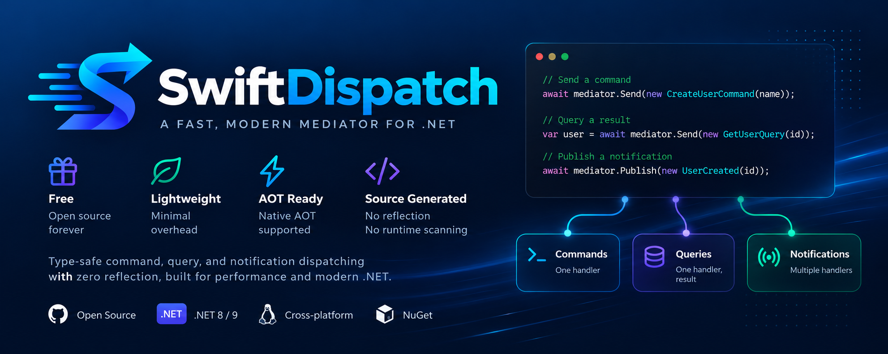

# SwiftDispatch



A free, lightweight **MediatR alternative** for .NET 10 with **Native AOT support**. Source generation handles registration and dispatch without runtime reflection.

## Quick start

Requires .NET 10. The `SwiftDispatch` package includes the source generator automatically.

Packages are currently built locally. Run `bash eng/verify.sh` to create them in `artifacts/packages`, then install:

```sh
dotnet add package Microsoft.Extensions.DependencyInjection
dotnet add package SwiftDispatch --source /path/to/SwiftDispatch/artifacts/packages
```

Configure your application's services:

```csharp
using Microsoft.Extensions.DependencyInjection;
using SwiftDispatch.Contracts;

var services = new ServiceCollection();
services.AddSwiftDispatch();

// Marks this project for source-generated handler registration and dispatch.
[GenerateSwiftDispatch]
internal static partial class DispatchRegistration;
```

Handlers in the current project are registered automatically. Set `HandlerAssemblyMarkers` to include other assemblies and `PipelineBehaviors` to select behaviors in execution order.

## Example

Define a request and its handler:

```csharp
using SwiftDispatch.Contracts;

public sealed record Hello(string Name) : IRequest<string>;

public sealed class HelloHandler : IRequestHandler<Hello, string>
{
    public Task<string> Handle(Hello request, CancellationToken cancellationToken)
        => Task.FromResult($"Hello, {request.Name}!");
}
```

Build the configured services and resolve the mediator to send the request:

```csharp
await using var provider = services.BuildServiceProvider();
await using var scope = provider.CreateAsyncScope();
var mediator = scope.ServiceProvider.GetRequiredService<IMediator>();

string greeting = await mediator.Send(new Hello("Ada"));
Console.WriteLine(greeting); // Hello, Ada!
```

Use `mediator.Publish(...)` for notifications. See the [sample](samples/SwiftDispatch.Sample.Console/Program.cs) for pipeline and notification examples.

## Samples

- [Console](samples/SwiftDispatch.Sample.Console/Program.cs): requests, pipeline behaviors, and notifications. Run `dotnet run --project samples/SwiftDispatch.Sample.Console`.
- [ASP.NET Core Web API](samples/SwiftDispatch.Sample.WebApi/README.md): a minimal API endpoint that dispatches a request through an injected mediator. Run `dotnet run --project samples/SwiftDispatch.Sample.WebApi -- --urls http://localhost:5080`.

## Migrating from MediatR

SwiftDispatch uses the same core interface names and handler patterns as MediatR, including `IMediator`, `IRequest`, `IRequestHandler`, `INotification`, and `IPipelineBehavior`. For these supported features, migration is straightforward: update your namespaces to `SwiftDispatch.Contracts` and replace your registration with the setup in [Quick start](#quick-start).

## Supported features

- Requests with or without responses using `Task`-based handlers.
- Streaming requests using `IStreamRequest<T>`, `IStreamRequestHandler<TRequest, T>`, and `mediator.CreateStream(...)`, with separate stream pipeline behaviors.
- Ordered pipeline behaviors with short-circuiting, retries, and exception handling.
- Notifications with multiple handlers, executed sequentially.
- Source-generated registration and dispatch with Native AOT and trimming support.
- Microsoft dependency injection integration and cancellation token forwarding.
- Handler discovery in explicitly included assemblies and constrained generic pipeline behaviors.

## License

Licensed under [MIT](LICENSE). Free for personal and commercial use.
