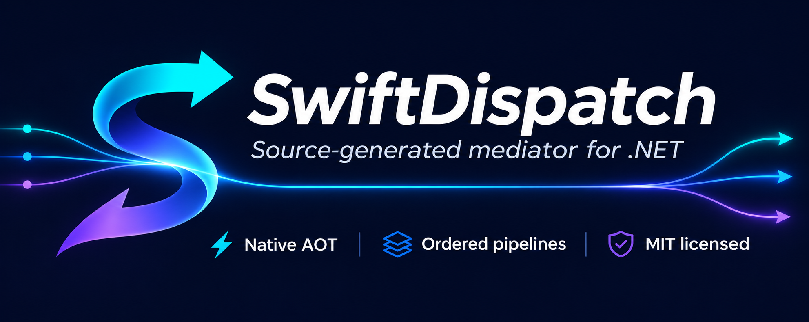

# SwiftDispatch



A free, lightweight MediatR alternative with Native AOT support.

Supports `netstandard2.0`, `net8.0`, and `net10.0`. Native AOT is supported on .NET 8 and .NET 10. Building this repository requires the .NET 10 SDK.

## Quick start

Install [SwiftDispatch from NuGet](https://www.nuget.org/packages/SwiftDispatch/0.1.0-beta.1). The package includes the source generator automatically and references `SwiftDispatch.Contracts`.

```sh
dotnet add package SwiftDispatch --version 0.1.0-beta.1
```

`0.1.0-beta.1` is a prerelease; APIs may change before the stable release.

Configure your application's services:

```csharp
using System.Reflection;
using Microsoft.Extensions.DependencyInjection;
using SwiftDispatch.Contracts;

var services = new ServiceCollection();
services.AddSwiftDispatch(options =>
{
    options.RegisterServicesFromAssembly(Assembly.GetExecutingAssembly());
});
```

Handlers in the current project are registered automatically. Register an assembly and add behaviors in outermost-first execution order:

```csharp
services.AddSwiftDispatch(options =>
{
    options.RegisterServicesFromAssembly(Assembly.GetExecutingAssembly());
    options.AddOpenBehavior(typeof(LoggingBehaviour<,>));
    options.AddOpenBehavior(typeof(ValidationBehaviour<,>));
});
```

Place this registration in the assembly containing your handlers, such as your Application-layer service-registration extension. `Assembly.GetExecutingAssembly()` identifies that assembly. Use `typeof(SomeHandler).Assembly` to include public handlers from another assembly; no dedicated marker class is required. The existing `AddHandlersFromAssemblyContaining<T>()` API is also available.

Configuration is read at build time. Use one direct lambda per assembly, either a fluent expression or a block containing registration calls on its options parameter. Supported calls are `RegisterServicesFromAssembly(...)`, `AddHandlersFromAssemblyContaining<T>()`, `AddOpenBehavior(typeof(...))`, `AddPipelineBehavior(typeof(...))`, and `AddStreamPipelineBehavior(typeof(...))`. The lambda is not executed at runtime; variables, arbitrary assembly expressions, helper methods inside the lambda, and conditions are unsupported and produce a generator diagnostic. To register repeatedly, put that single call in a helper and invoke the helper multiple times.

## Example

Define a request and its handler:

```csharp
using SwiftDispatch.Contracts;

public sealed record Hello(string Name) : IRequest<string>;

public sealed class HelloHandler : IRequestHandler<Hello, string>
{
    public Task<string> Handle(Hello request, CancellationToken cancellationToken)
        => Task.FromResult($"Hello, {request.Name}!");
}
```

Build the configured services and resolve the mediator to send the request:

```csharp
await using var provider = services.BuildServiceProvider();
await using var scope = provider.CreateAsyncScope();
var mediator = scope.ServiceProvider.GetRequiredService<IMediator>();

string greeting = await mediator.Send(new Hello("Ada"));
Console.WriteLine(greeting); // Hello, Ada!
```

Use `mediator.Publish(...)` for notifications.

## Sample

- [Clean architecture](sample/SwiftDispatch.Sample.CleanArchitecture): separate domain, application, infrastructure, and API projects with application pipeline behaviors. Run `dotnet run --project sample/SwiftDispatch.Sample.CleanArchitecture/Web -- --urls http://localhost:5081`.

## Migrating from MediatR

SwiftDispatch uses the same core interface names and handler patterns as MediatR, including `IMediator`, `IRequest`, `IRequestHandler`, `INotification`, and `IPipelineBehavior`. For these supported features, migration is straightforward: update your namespaces to `SwiftDispatch.Contracts` and replace your registration with the setup in [Quick start](#quick-start).

## Supported features

- Requests with or without responses using `Task`-based handlers.
- Streaming requests using `IStreamRequest<T>`, `IStreamRequestHandler<TRequest, T>`, and `mediator.CreateStream(...)`, with separate stream pipeline behaviors.
- Ordered pipeline behaviors with short-circuiting, retries, and exception handling.
- Notifications with multiple handlers, executed sequentially.
- Source-generated registration and dispatch with Native AOT and trimming support.
- Microsoft dependency injection integration and cancellation token forwarding.
- Handler discovery in explicitly included assemblies and constrained generic pipeline behaviors.

## License

Licensed under [MIT](LICENSE). Free for personal and commercial use.
