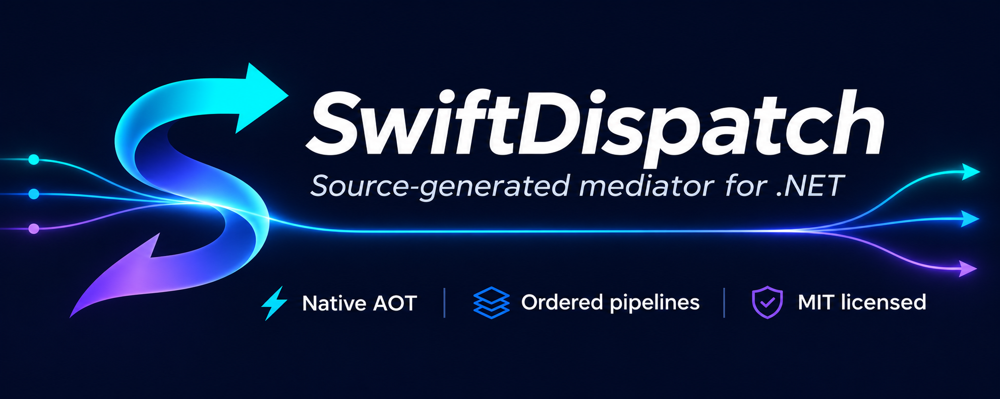

# SwiftDispatch



A free, lightweight MediatR alternative with Native AOT support.

Supports `netstandard2.0`, `net8.0`, and `net10.0`. Native AOT is supported on .NET 8 and .NET 10. Building this repository requires the .NET 10 SDK.

## Quick start

Install [SwiftDispatch from NuGet](https://www.nuget.org/packages/SwiftDispatch/1.0.0). The package includes the source generator automatically and references `SwiftDispatch.Contracts`.

```sh
dotnet add package SwiftDispatch --version 1.0.0
```

```csharp
using System.Reflection;
using Microsoft.Extensions.DependencyInjection;
using SwiftDispatch;
using SwiftDispatch.Contracts;

var services = new ServiceCollection();
services.AddSwiftDispatch(options =>
{
    // Register once; use typeof(SomeHandler).Assembly for another assembly.
    options.RegisterServicesFromAssembly(Assembly.GetExecutingAssembly());

    // Optional: run notification handlers in parallel (sequential by default).
    // Parallel handlers share a scope; dependencies must support concurrent use.
    // options.UseNotificationExecutionStrategy<ParallelNotificationExecutionStrategy>();

    // Optional: add your pipeline behaviors in outermost-first order.
    // options.AddOpenBehavior(typeof(LoggingBehaviour<,>));
    // options.AddOpenBehavior(typeof(ValidationBehaviour<,>));
});

await using var provider = services.BuildServiceProvider();
await using var scope = provider.CreateAsyncScope();
var mediator = scope.ServiceProvider.GetRequiredService<IMediator>();

string greeting = await mediator.Send(new Hello("Ada"));
Console.WriteLine(greeting); // Hello, Ada!
// Use mediator.Publish(notification) for notifications.

public sealed record Hello(string Name) : IRequest<string>;

public sealed class HelloHandler : IRequestHandler<Hello, string>
{
    public Task<string> Handle(Hello request, CancellationToken cancellationToken)
        => Task.FromResult($"Hello, {request.Name}!");
}
```

## Sample

- [Clean architecture](sample/SwiftDispatch.Sample.CleanArchitecture): separate domain, application, infrastructure, and API projects with application pipeline behaviors. Run `dotnet run --project sample/SwiftDispatch.Sample.CleanArchitecture/Web -- --urls http://localhost:5081`.

## Supported features

| Feature | Support |
| --- | --- |
| Requests | Requests with or without responses using `Task`-based handlers |
| Streaming | `IStreamRequest<T>`, `IStreamRequestHandler<TRequest, T>`, and `mediator.CreateStream(...)` with separate stream pipeline behaviors |
| Pipeline behaviors | Ordered execution, short-circuiting, retries, and exception handling |
| Notifications | Multiple handlers with sequential (default), parallel, or custom execution strategies |
| Native AOT and trimming | Source-generated registration and dispatch |
| Dependency injection | Microsoft dependency injection integration and cancellation token forwarding |
| Handler discovery | Explicitly included assemblies and constrained generic pipeline behaviors |

## Contributing

See [Contributing to SwiftDispatch](CONTRIBUTING.md) for setup, coding conventions, testing, and pull request guidelines.

Please follow our [Code of Conduct](CODE_OF_CONDUCT.md) in all project spaces.

## Security

See our [security policy](SECURITY.md) for supported versions and how to report vulnerabilities privately.

## License

Licensed under [MIT](LICENSE). Free for personal and commercial use.
